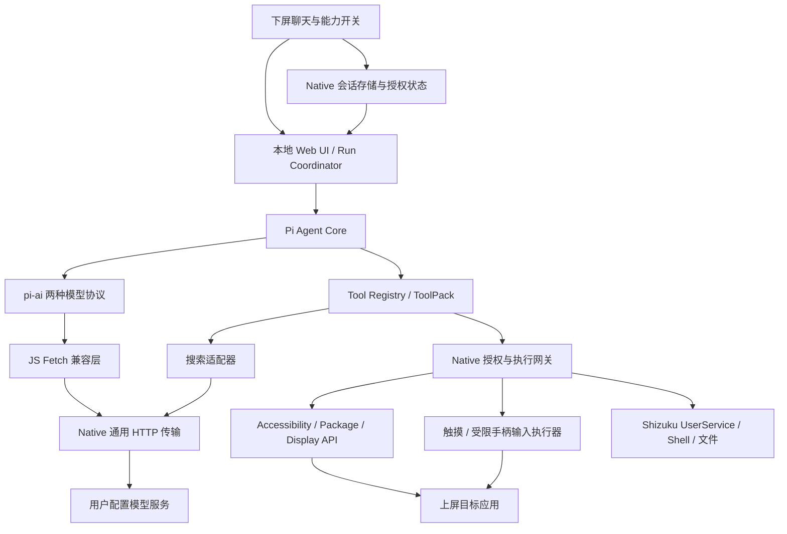

# 总体架构与分层

> 2026-10-13 状态更新：五模块已开发并进入正式软件整合。本文早期“仅规划/未授权/无 APK”等叙述保留其历史背景；当前实现、实际测试与尚未完成的 Thor 验收，以 [中文集成报告](integration-report.md) 为准。来源模块旧测试不等于本次集成结果。
[决定] 采用 Kotlin Android 宿主＋本地 WebView 中的聊天 UI 和 Pi 运行时。具体 UI 框架推迟到 PoC；不引入服务端 Agent。该选择以 POC-03/04 通过为条件。

## 模块责任和禁止事项

| 层 | 拥有的事实与责任 | 不应承担 |
|---|---|---|
| app | 生命周期、主屏映射设置、系统授权、凭据和本地存储；承载 WebView | 不组装模型请求 JSON |
| runtime | UI、Agent Run 编排、Pi 协议适配、模型上下文投影、JS 工具定义 | 不直接拥有 Shell/真实凭据/数据库文件访问 |
| native-bridge | 受限 IPC、Fetch 字节传输、凭据引用、Session 授权网关 | 不解析模型 SSE、tool_use、function_call、图片协议 |
| tools | 感知/搜索/输入/调试 ToolPack；原生设备实现与 JS 定义通过契约关联 | 不绕开授权入口；不将任意 Shell 当普通工具内部捷径 |
| storage | Session/Run/Event/附件/配置持久化单一事实源 | 不把模型完整 payload 当会话数据库 |

这些是逻辑所有权；Native 中存在设备工具与权限理解是必要的，用户要求“协议无感”约束的是模型传输，不是要求 Native 对设备权限无感。

## 一轮执行

1. UI 把用户 Message 写入 Native 事务；Run Coordinator 创建 Run，绑定 Session、模型配置修订和能力修订。
2. 每次模型请求前读取最新授权、可用性与 L0 快照；生成新的 ContextSnapshot 和工具集合。历史系统段不允许重新声明已撤销工具。
3. Pi 经 pi-ai 构造完整请求；Fetch 桥携带受约束的 network purpose 与 credentialRef，Native 发送 HTTP 并转发字节。
4. 模型返回工具调用，Pi 完成参数解析；Registry 校验，Native 再校验 Session、Run、epoch、工具及资源范围。
5. 执行器发进度/结果；写 ToolEvent 和必要附件；Pi 获得有大小边界的模型结果。
6. Pi 请求下一轮或结束；持久化终态完成后 UI 折叠执行轨迹。停止/失败也有明确终态。

## 双重校验而非双重权限事实源

Native Capability Store 是唯一授权事实源，Runtime 只有版本化镜像。工具注入减少模型能提出的行动；Native 校验阻挡伪造、过期调用和撤销竞态。任何参数里的 SessionId、toolId 或 capability 都不直接被信任，必须与 Native 已签发的 Run 绑定关系匹配。

调用在 Native 检查与排入执行队列时原子绑定权限版本；紧接实际副作用前再次检查。长动作分段检查；每个子进程和输入序列有取消句柄。细节见 [工具系统](tool-system.md)。

## 生命周期与故障域

首版只保证应用前台可交互时运行。WebView renderer 退出、宿主进程退出、Shizuku binder 死亡、屏幕映射改变都结束对应执行租约。仍存活的原生执行器负责清理网络请求、子进程和按键释放；受限输入后端须有独立租约超时。若宿主和后端同时消失，不能保证释放回调被执行，结果标为未知并纳入故障验证；重开 UI 从数据库恢复，旧 Run 只显示 interrupted，不继续执行。

不把“放入 Android Service”写成 WebView 可在后台无限存活的保证。若后续要后台运行，另开 ADR 讨论前台服务类型、通知和系统限制。

## 扩展边界

新工具加入注册表，不新增模型循环分支；新模型协议只进入 JS pi-ai 适配；MCP 将来转换成同一 ToolDescriptor 和执行器，受同样权限/取消/结果预算约束。首版不做远程插件下载、动态脚本执行、MCP stdio 进程管理。

## 独立测试拓扑

新增 [Thor Input Lab](input-lab.md) 测试 APK，占据上屏目标应用位置；与 Agent 独立安装、进程、UID 和数据。前期手动诊断面板调用 Native 适配器，后期 Agent 经产品网关调用相同待测输入链路；两者经过 Android 分发后由 Lab 收集接收事件和状态。

受信 runner 的场景准备/报告通道与输入通道分开，不能直接制造事件或写通过结果，也不作为模型可调用工具。正式 Thor Agent 不依赖 Lab，输入发布回归必须先有 Lab 证据并保留真实模拟器验证。接收器自身的判定代码不共享 Agent 坐标变换实现，避免相同错误相互掩盖。

## 已落地的软件整合

根 Gradle 统一编译正式 App、Native Core/Android 桥、设备 Core/Android library、独立 Input Lab 和两个诊断宿主。App 预构建打包无 Node/外部模块导入的 Pi browser bundle。

产品授权由 Native Authority 拥有，持久化由 ProductHost/SQLite拥有；原独立 Coordinator 和 ManualTestAuthority 不参与正式授权。前台只保留一个 Native Run，Activity singleTask；页面连接/前台生命周期失效立即撤销执行。UI 在 Native 收尾完成前仍阻止新发送。

设备工具经真实 Gateway 与 bundled复杂 schema 校验；网络工具也登记 purpose/profile，并受 Native 搜索能力和 SSRF 控制。Native transport 不解析模型 JSON/SSE。批准卡、领域回合、ContextSnapshot/附件及图片工具回传已接入，详细限制与证据见集成报告。
