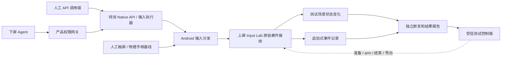

# 上屏独立测试 APK：Thor Input Lab

> 2026-10-13 状态更新：五模块已开发并进入正式软件整合。本文早期“仅规划/未授权/无 APK”等叙述保留其历史背景；当前实现、实际测试与尚未完成的 Thor 验收，以 [中文集成报告](integration-report.md) 为准。来源模块旧测试不等于本次集成结果。
状态：规划，未实现、未构建、未安装、未实测。日期：2026-10-13。关联 REQ-21～25、POC-11、ADR-011。

## 1. 定位与独立边界

[需求] 新增独立上屏测试 APK，作为前期手动 API 测试和后期 Agent 执行测试的共同接收端和结果依据。

[决定] 暂名 **Thor Input Lab**，规划目录 `tests/input-lab-app/`。具有独立 applicationId、进程、UID、数据目录和安装包；正式包名/签名策略在开发前冻结，不与 Thor Agent 共用 UID。不嵌入模型、Pi、网络搜索、Shizuku 或输入注入器。无需 Thor Agent 启动即可手动打开，接收用户的实际触摸和物理手柄事件。

它是测试辅助应用，正式使用 Thor Agent 操作游戏不依赖安装它；但发布所需的输入/感知回归必须先在该接收端通过。实验室通过后仍测试真实模拟器，不能据自建接收端成功推断所有游戏兼容。

[决定] 使用 Kotlin 和原生 Android View/自绘测试区域，便于分别观察原始分发事件与控件语义。测试接收逻辑、场景状态机和断言不复用 Agent 的坐标变换/输入适配代码，避免双方共享同一错误而相互证明正确。可以共享版本化报告字段说明，不能共享用于判分的预期计算实现。

## 2. 三方关系与证据链

**动作数据通道**必须经过真实 Android 跨应用输入分发；**测试控制通道**只管理场景、记录和报告。不存在 setPassed、写事件、替 Agent 点击目标、直接完成关卡等接口。测试 APK 不把录制输入回放成系统注入。

三层结果单独记录：①调用端 submitted/错误；②接收端 received 的原始事件；③场景 observed 的状态/断言。只满足①不能判通过。通用 API 调试只报告其实际覆盖，不冒充经过完整产品权限网关。

## 3. 页面与可重现场景

上屏顶部显示当前显示 ID/角色校准状态、窗口焦点、场景与版本、testRunId 短码、armed/recording/finished、丢事件/日志完整性状态。主体为当前测试场景；底部/抽屉显示原始事件与业务结果。记录开始后收起会影响命中的工具栏，固定布局，禁止持续动画改变目标位置。

| 页面/场景 | 可视内容与状态 | 验证目标 |
|---|---|---|
| 环境与焦点 | 应用版本、显示/窗口尺寸、旋转、insets、生命周期/焦点时间线 | 上下屏映射、下屏键盘/聊天抢焦点、显示重建 |
| 点击靶场 | 固定种子生成网格和带编号/颜色的目标，命中/误触计数 | 坐标、边缘、裁剪/缩放映射、点击恰好一次 |
| 手势轨迹 | 路径、每指指针 ID、按下/移动/抬起/取消 | 长按时长、滑动方向/终点、多指接收能力 |
| 原生控件 | 按钮、开关、滑块、列表、文本框、弹窗 | UI 树/节点定位、滚动、语义动作、输入法焦点 |
| 手柄面板 | 按钮灯、摇杆轨迹、扳机条、D-pad、设备/来源 | down/up、repeat、轴范围/死区、组合与归零 |
| 小型任务场景 | 用方向/摇杆移动游标，按确认触发目标 | Agent 多步观察—操作—验证闭环；分别启用触摸或手柄输入模式 |
| 视觉/感知靶场 | 版本化随机色块、文字、计数和图形；可切换有语义 View / 无细粒度语义自绘区域 | 截图是否新鲜、应用版本、UI 树不完整的正确处理 |
| 受保护画面 | 单独场景启用窗口安全标记并明确显示模式 | 安全窗口截图失败/屏蔽的识别；不绕过系统保护 |
| 合成配置（次阶段） | 可恢复的测试开关、原文/hash、应用内导入/导出 | 结构化文件读写/备份恢复；不接触真实游戏存档 |

原生控件场景接受 Android 正常分发；裸输入场景只按指定输入事件改变任务状态。无障碍 ACTION_CLICK 可以造成控件状态变化但无触摸序列，因此记录为 semantic-only，不能计入触摸注入通过。手柄任务不得把键盘箭头/屏幕点击静默转换成“手柄命中”。

不要求 Agent 首版已支持多指、悬停、鼠标或文本注入：接收端可记录这些事件，产品未支持项目标为 not_applicable/unsupported，不新增未经批准的产品功能。Home 等系统保留键可能不会送达应用，不试图截获，也不把缺失一概归为输入后端故障。

## 4. 接收 API 与字段

[事实] Activity 提供 dispatchTouchEvent、dispatchKeyEvent、dispatchGenericMotionEvent 及窗口焦点回调；KeyEvent、MotionEvent、InputDevice 提供相应事件/设备元数据。这里只接收送达本应用窗口的事件，不能用普通 APK 全局监听其他应用输入。[Activity](https://developer.android.com/reference/android/app/Activity)、[KeyEvent](https://developer.android.com/reference/android/view/KeyEvent)、[MotionEvent](https://developer.android.com/reference/android/view/MotionEvent?authuser=00)、[InputDevice](https://developer.android.com/reference/android/view/InputDevice)。

拟议记录规范如下，字段缺失用 null＋reason，不虚构设备身份或事件 display：

| 记录层 | 必需字段与规则 |
|---|---|
| 公共头 | schemaVersion、testRunId、caseId、attemptId、receiverEpoch、sequence、eventKind、recordOrigin、接收时间、场景/布局版本 |
| Motion 原始事件 | actionMasked/actionIndex、pointerCount、每个 pointerId/toolType/x/y、可得的 rawX/rawY、pressure/size、source 位掩码、deviceId、buttons/meta/flags、downTime/eventTime |
| Motion 历史 | historySize、逐历史样本时间/坐标/相关轴；保留 batch 和 sample 序号，不能只记录最后 MOVE |
| Key 原始事件 | action、keyCode、scanCode、repeatCount、metaState、flags、source、deviceId、downTime/eventTime；重复 DOWN 不当新按键 |
| 轴 | X/Y/Z/RZ、RX/RY、LTRIGGER/RTRIGGER、BRAKE/GAS、HAT_X/HAT_Y 等实际存在轴的原值；依据设备能力枚举，不假设每个控制器相同 |
| 设备快照 | 可得的 name、descriptor、vendor/product、isVirtual、sources、各轴 min/max/flat/fuzz/resolution；按连接变化记录修订 |
| 接收窗口 | actualWindowDisplayId、窗口位置/尺寸、旋转、insets、hasWindowFocus、生命周期、布局 hash；事件自身 displayId 仅在目标 API 的公开能力支持时填入 |
| 场景变化 | 命中目标、误触、计数、before/after、触发原始 sequence 或 semantic 回调来源 |
| 诊断事件 | 设备增删、窗口失焦、显示变化、队列溢出、进程重启、控制通道失联、手工重置 |

在 Activity 分发边界记录一次原始事件，子 View 回调只记录关联语义，不能重复算成两次输入。先复制字段/必要历史再异步写盘，避免持有系统复用的 MotionEvent；记录不能阻止标准分发。source 按位掩码判断，不能用单值相等测试推断复合输入设备能力。

source、deviceId、flags 不足以可靠鉴别“真人输入还是 Agent 注入”。recordOrigin=android_dispatch 表示来自应用分发入口，不是加密来源证明；不能在普通事件里找到不存在的 Agent runId/toolCallId。

## 5. 时间、坐标与状态真实性

MotionEvent/KeyEvent 的事件时间按相应 Android API 定义记录；MotionEvent.eventTime 使用 uptime 时间基，SystemClock.elapsedRealtime 则包含深睡，两者不得直接相减。[MotionEvent 时间](https://developer.android.com/reference/android/view/MotionEvent?authuser=00)、[SystemClock](https://developer.android.com/reference/android/os/SystemClock?authuser=383)。

报告同时保留 receivedUptimeMs 与 receivedElapsedRealtimeNanos，标注单位/clockId；同设备同次启动且时基一致的发送端/接收端日志可关联。桌面 wall clock、模型耗时和设备输入延迟分开。注入方可设置事件时间，因此不能把 receivedTime-eventTime 当可靠的端到端物理延迟。

场景定义独立保存窗口/内容坐标和目标 bounds。收到的 local 坐标经接收端自己的窗口几何映射判断；frame/crop/scale 的发送端参数只作为对照，不充当接收端真值。旋转/布局重建使 layoutEpoch 变化，当前用例结束为 inconclusive 或按指定失效测试断言判定，不能继续用旧靶点判通过。

屏幕显示的“当前按住”由实际事件驱动。失焦、设备断开、超时或准备下一用例时，不得伪造 UP/轴归零让测试看似清理成功；保留最后观测值并标记 stale/unknown。看门狗只能改变诊断状态；真正释放通过必须看到要求的 UP/归零证据。缺少事件也不能推断系统仍持续按住，只能说接收端尚未观察到释放。

## 6. 测试控制、人工流程和后期自动化

### 前期手动 API 测试

受信测试控制端可以先是人在 Input Lab 内选择场景/arm，读取本地结果并导出。手动调用端计划为 Thor Agent 开发壳中的诊断面板，在完整 Pi 接入之前复用待测 Native 适配器；也允许桌面 ADB 作明确标注的对照路径，不为此另规划第三个必需 APK。

流程：打开上屏 Lab → 选择/准备场景 → 用实体手柄或手指做基线 → 建立独立 attempt 并 arm → 下屏手动调用待测 API → 上屏查看原始事件和任务结果 → 封存报告。准备按钮触摸发生在 arm 前；开始前必须等已按指针/按键释放，避免准备动作污染计数。

mode 区分 physical_baseline、manual_platform_api、manual_product_gateway、agent_e2e。只有 manual_product_gateway 和 agent_e2e 可用于证明产品权限限制；直接 Shell/平台 API 测试不具有该覆盖。

### 后期 Agent 执行测试

受信 runner 准备相同场景，建立 scenarioVersion＋seed＋testRunId＋attemptId，收到 ready 后触发 Agent 正常用户任务。Agent 通过实际感知/操作工具交互；runner 在外部收集 Agent Run/ToolEvent 和 Lab 原始记录、断言，比较成功率/误触/释放等。

给模型的只有正常任务描述及被授权感知结果；隐藏预期坐标、设备断言和控制 API 不注入 Tool Registry。模型可从正常画面读到结果，不能读取隐藏判分答案或通过测试 IPC 重置场景。纯输入测试可明确给定坐标；视觉定位测试不能给模型目标的机器真值。

### 控制通道方案

第一阶段无需 IPC：应用内操作＋本地报告导出即可验收。自动化阶段首选专用 bound service/Binder 的版本化测试协议，显式组件、签名级权限和允许的测试调用方证书/UID，配合用户本地开启及短期测试 lease。两 APK 用开发测试签名建立信任但仍独立 UID；生产 Thor Agent 不开放此通道。正式身份方案由 Q-18 验证。[Android 跨应用权限](https://developer.android.com/training/permissions/restrict-interactions)。

拟议方法：describe（版本/可用场景）、prepare（受限 fixture 配置）、arm、getStatus、readEvents（游标/分页）、finish、exportReport。reset 只可在未记录时进行且产生审计事件；不得删改已封存 attempt。控制调用不启动/抬升 Activity、不自动抢焦点，尽量避免读取报告干扰焦点测试。IPC 掉线不清空接收记录，恢复后按游标补读。

测试控制只连接受信 harness，不暴露为模型工具或通用 Native bridge 方法。首版不使用无鉴权 HTTP 服务、全局可调用 broadcast、写任意文件或可写事件 provider。调试 Shell 授权很强，恶意篡改测试环境不在此可信验收假设内；Shell 用例不得操作 Lab 报告/控制身份，不能据此宣称防作弊隔离。

## 7. 场景规范与断言

每用例固定 caseId、scenarioVersion、seed、inputMode、preconditions、stimulusDescription、expectations、tolerances、observationWindow、cleanupPolicy。阈值在执行前冻结并写入报告，不可看完结果再调到通过。初值：一次输入观察窗口 5 秒、释放观察 1 秒、稳定静默窗口 300ms；均为可配置试验初值，不是所有固件的性能保证。

状态机：idle → prepared → armed → recording → finished；中途可 aborted/interrupted。finish 等待规定静默窗口并记录截止 sequence；随后到达的事件记为 late，不直接抹去，下一 attempt 前先 drain。中途重置、崩溃、显示 epoch 变化按用例规则 fail 或 inconclusive，不能自动续写为同一完整 run。

| caseId | 场景与刺激 | 通过证据 / 关键反例 | 关联 |
|---|---|---|---|
| LAB-01 | 上屏显示校准、下屏打开输入法 | 实际窗口 display 和焦点序列完整，角色映射确认 | POC-01 |
| LAB-02 | 单击指定靶点 | 完整 DOWN/UP＋指定靶点恰好一次；semantic-only 不通过触摸断言 | POC-06 |
| LAB-03 | 边缘/旋转/裁剪缩放靶点 | receiver 几何中的目标命中、无邻近误触；布局失效按规则拒绝 | POC-02/06 |
| LAB-04 | 长按、滑动、取消 | 接收时序/轨迹与结果符合容差，取消不算正常 UP 完成 | POC-06 |
| LAB-05 | UI 树/控件语义；自绘视觉靶场 | 节点/截图来自当前 sceneRevision；明确无细粒度树场景 | POC-02/03 |
| LAB-06 | 手柄按钮和 D-pad | 指定 source 分类，正确键值/配对/重复；键盘来源不冒充手柄 | POC-07 |
| LAB-07 | 双摇杆、扳机扫描 | 对实际运动范围验证方向、幅度、neutral 与历史样本；缺轴单独失败 | POC-07 |
| LAB-08 | 按钮组合、按钮＋轴 | 观测到状态重叠与正确释放；顺序快速点击不冒充同时按住 | POC-07 |
| LAB-09 | 下屏输入/聊天焦点切换时操作 | 每步接收焦点/display 与事件关联；未接收不直接判断发给下屏 | POC-01/07 |
| LAB-10 | 关闭能力/停止/断开 Shizuku | 旧调用无新业务事件，已持有输入释放独立检查；允许的清理事件不误判越权 | POC-05/07 |
| LAB-11 | Agent 完成若干目标/菜单任务 | Lab 任务状态及原始事件满足条件；Assistant 自称成功不计 | POC-10 |
| LAB-12 | 合成配置读写/备份恢复 | Lab 实际读回合成值/hash 与恢复结果；不特判放开私有目录 | POC-08 |
| LAB-13 | 接收器重启、日志满、控制断线 | 新 receiverEpoch、缺口计数/不确定状态可见，不出伪完整报告 | POC-11 |
| LAB-14 | 不动作/错误按键/错误来源/语义点击的负例 | 判定器能拒绝已知错误，而非任意输入都通过 | POC-11 |

负向“没有事件”用例只有在接收器存活、日志无缺口、测试窗口完整且前后正向对照通过时可作为证据；失焦/失联导致的零事件必须区别处理。权限撤销的强结论还需 Native 阻断记录，不能仅由 Lab 没收到事件推出。

testRunId 是控制通道准备的关联 ID，不会天然附在系统输入事件里。初版每设备只允许一个活动 attempt，组合输入在该 attempt 内明确编排；按 arm/end 时间和 sequence、Agent runId/toolCallId 的发送端时间窗关联。无法一一对应的事件标为 ambiguous，物理输入与 Agent 并发时不根据 deviceId 猜来源。用隔离实验建立基线，另设人为干扰场景。

## 8. 报告与记录完整性

统一报告包含：reportSchemaVersion、Lab 版本/构建标识、固件/API、两屏信息、设备快照、case/场景/种子/布局版本、测试模式、testRunId/attemptId/receiverEpoch、关联 Agent runId 与 sender trace 引用、预期/容差、原始事件区间、场景前后状态、断言及理由、缺口/迟到/人工干预、附件与 hash。

判定为 pass、fail、inconclusive、blocked、not_applicable；未执行不能标 pass。unsupported 是阻塞原因，是否影响首版发布由需求决定。报告至少同时给人可读摘要和结构化 JSON/事件 JSONL 的未来导出格式；此时不创建 schema 文件或模拟报告。

Raw log 追加式，UI 可以降频刷新但不可把 UI 抽样当完整记录。初值每 attempt 最多 100,000 事件/样本或 32 MiB，先到上限则标 incomplete 并结束采集，绝不静默覆盖旧事件。采集队列溢出显式 drop 计数；包含该缺口的完整性断言不可通过。报告 hash 用于发现意外损坏，不宣传为防篡改签名。

默认本地保存最近 50 份报告、总额 200 MiB，预算满先拒绝新测试并提示人工导出/清理；不在运行中删除当前或唯一失败证据。报告不含模型 key，设备 descriptor 默认仅测试内保留/对外导出散列化；用户导出使用明确授权路径。

## 9. 接收器自身先验收（POC-11）

在它成为其他测试的可信依据前：人工触摸/物理手柄基线；验证原始事件只计一次且业务状态可追溯；已知成功/失败/不动作均正确判定；semantic-only 不冒充 raw touch；错误 source 不冒充手柄；失焦不伪造释放；异常/溢出报告不完整；IPC 身份拒绝及无写判分接口；重置不能洗掉已完成证据。

录制样本回放只允许离线验证 parser/判定器，不经系统注入、不混入实时证据；recordOrigin=fixture_replay 的报告不能用于证明跨屏输入通过。接收器的能力校准与限制写入 receiverQualificationVersion，场景或判定算法变动必须重跑相关自检。

## 10. 实施顺序与边界

M1a：独立 APK 环境页、原始事件接收、触摸/手柄面板、本地报告，完成 POC-11 最小资格验证；M1b：手动 API/焦点测试，对接 POC-01/02/06/07；M2：受限 runner 通道和同场景 Agent 回归；M5：合成配置 fixture；M6：受支持固件上的统一回归。

LAB 报告证明“此接收端在此设备/配置下的事件和状态”，不证明其他应用也会接受、系统所有屏幕都没有收到误输入或物理硬件手柄身份完全一致。保留真实模拟器回归，也保留模型网络、搜索和安全测试各自的证据服务；Input Lab 不承担这些服务的全部验证。

下一步仅在另行授权开发后实施。当前仍无 Manifest、Gradle、Activity 源码、自动化脚本或 APK。
