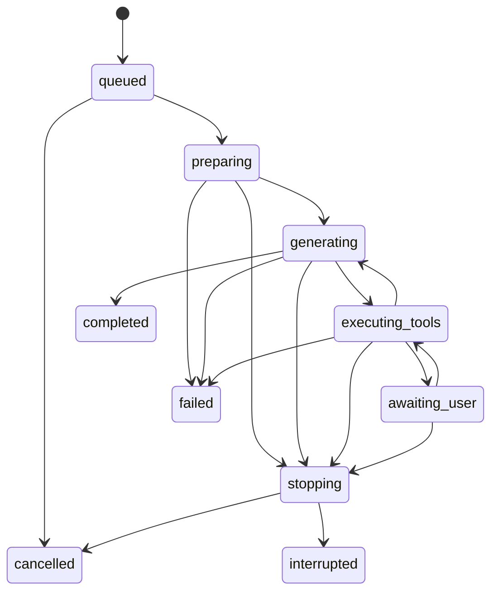

# 会话、消息、Run、事件与模型上下文

> **2026-10-17 当前实现更新：** 执行、模型上下文、自动压缩和会话恢复已交由正式 Pi `AgentSession` / `SessionManager` 管理，详见 [Pi 会话与上下文职责](pi-session-ownership.md)。下文由 Thor 每轮编译 DomainTurn、保留固定轮数、自行裁剪/摘要，以及从展示历史重建模型上下文的段落属于旧设计，已不再作为当前实现依据。运行状态和页面事件仍按各自职责保留。

> 2026-10-13 状态更新：五模块已开发并进入正式软件整合。本文早期“仅规划/未授权/无 APK”等叙述保留其历史背景；当前实现、实际测试与尚未完成的 Thor 验收，以 [中文集成报告](integration-report.md) 为准。来源模块旧测试不等于本次集成结果。
## 五个独立对象

| 对象 | 职责 | 不等同于 |
|---|---|---|
| Session | 标题、能力意愿、模型配置、时间、归档状态 | 一个始终存活的 Pi Agent 实例 |
| Message | 用户输入和可展示 Assistant 输出，引用附件/所属 Run | 全量工具日志或模型 payload |
| AgentRun | 一次用户触发的执行，含多次模型调用和工具调用、状态/限制 | 一条 Assistant 消息 |
| ToolEvent / RunEvent | 开始、进度、结果、错误、取消、授权变化等审计 | 每轮必须重发给模型的历史 |
| ContextSnapshot | 针对某次模型请求编译的消息/工具/环境投影与来源 manifest | 直接照抄 UI 列表 |

Pi 的 AgentMessage 和 transcript 是协议/运行时对象，不直接作为本地数据库 schema。Native 保存领域事实，Runtime 适配锁定 Pi 版本；升级不强制迁移所有 UI 历史为新 Pi 对象。

2026-10-16 更新：活动宿主为每个会话复用一个 Pi Agent 和 sessionId；每个新 Run 重绑最新模型、工具、端口与权限，历史仍经过来源过滤和模型上下文预算编译。追问继续已有会话，只有新建会话才隔离历史。普通模型任务没有整轮或生成等待时间上限，连接建立失败、单工具超时、用户停止和授权撤销仍有对应结果。配置连接探测独立保留三分钟上限。

## 运行状态机

awaiting_user 用于明确的危险操作确认或缺少必要信息；不要求普通只读工具每步确认。进程退出时所有非终态 Run 恢复为 interrupted。终态只能确定一次；迟到模型 token、工具事件附为诊断，不重新把 Run 置回运行中。

0.5.0 起，不同 Session 可以同时运行，每个 Session 至多一个活动 Run，Native 同时接纳最多 8 个。各运行独立持有 Runtime、模型/思考强度快照、网络上下文、授权 lease、工具发布集合、取消和去重记录。切换只改变查看对象；输入框发送按钮仅停止当前会话，侧栏标识其他运行。实际设备动作仍串行执行，等待批准不占用执行队列。创建新会话复制上次选择的能力、模型、思考强度和 Skill 挂载选择，不复制历史、草稿或待发送图片。

## 事件与一致性

每个事件有 sessionId/runId/eventId/sequence/toolCallId（适用时）、wallTime 和 monotonic elapsed。工具副作用开始前保存 intent，结束写结果；崩溃在中间时记录 outcome=unknown，不重新执行。基于 runId＋toolCallId 去重，遇到相同 id 不同参数视协议错误。

高频 token 可合并持久化（初值每 250ms 或 4KiB，待测试），工具开始/结束、授权变化和 Run 终态即时提交。UI 订阅事件形成显示投影，掉线后可从 sequence 续读。UI 折叠状态单独保存，不能通过删除 ToolEvent 实现折叠。

## 上下文编译

每次请求：静态产品说明 → 唯一最新 L0/能力摘要 → 经筛选的历史与摘要 → 当前用户请求与当前未闭合工具回合 → 当前有效工具声明。具体协议中的位置由 Pi 适配，不向 Native 暴露消息角色分支。

动态环境/工具不能在旧系统消息回放后复活。ContextSnapshot 记录 modelProfileRevision、capabilityEpoch、registryVersion、L0 snapshotId、包含消息 ID、附件引用、预算估计、压缩策略版本和内容 hash。默认仅保留 manifest，不永久保存含 key 的完整请求，且构造时不应存在真实 key。

## 压缩策略

0.5.0 起按当前 provider/model profile 的 contextWindow 分配上下文，并预留 maxOutput；不再额外固定截到 70%。OpenCode Go 使用可刷新、带缓存的 Pi 模型资料；DeepSeek V4.1 Flash 为 1,000,000 tokens。自定义 API 使用用户填写的上限。token 计数可用 provider usage 校正，不支持精确 tokenizer 时标记 estimated。图像成本单独估算，不用字符长度当图片 token 数。

1. 保留当前用户目标、明确约束、最近必要对话和所有尚未闭合的 tool call/result；不拆孤立 toolResult。
2. 去掉过期截图、重复窗口/UI 树大段输出，用带来源 ID 的短摘要代替；附件留在本地，不每轮上传。
3. 对较早完整 Run 做摘要，保留做过什么、结果、待确认项、配置备份 ID、发生过的不可逆副作用，避免重复操作。
4. 摘要版本化并记录原消息范围和 hash；原消息不删除。摘要也带来源权限标签，关闭相应能力后不得通过摘要重新泄露旧工具数据。
5. 摘要失败/超时使用确定性裁剪完整历史回合；若当前必要内容仍超限，停止并提示拆分任务，而不是删掉工具配对硬发请求。

能力撤销造成来源过滤时，以完整已闭合回合为移除单位，不只删 toolResult 留下悬空调用。当前尚未闭合回合先取消执行并记录授权失败/取消结果；若不能形成合法且不泄漏旧数据的模型投影，则结束该 Run，后续由新 Run 在最新权限下继续。不能以“保留配对”为理由继续发送被撤销来源的原始数据。

压缩本身若调用模型，属于当前 Run 的模型调用，有预算和取消，不能暗中再截图/搜索。模型输出中的隐式推理不是必需持久化或展示对象；UI 重点显示可核实动作和状态。

## 图片与工具结果

本地工具结果保存附件 ID 和元信息；Pi projection 在当前请求需要时读入图片。不同 provider 对图像 toolResult 的表达由其 adapter/JS 消息投影负责。模型不能仅凭本地 path 访问图片，也不能假设 tool output 的字符串路径会被自动识图。

当前感知禁用、附件已删除、已过时或超预算时替换为明确不可用说明，不编造图像内容。用户从历史 UI 手动查看图片不会自动把它加入下一次模型请求。

## 恢复与验证

恢复 Session 只重建聊天和已确定结果，旧 Run 不自动继续。用户点击继续会生成新 Run、新权限快照和新环境；已执行副作用被明确列出。POC-10 覆盖失败后展开、切会话、压缩跨工具回合、图片过期、进程退出和部分写入。

失败、取消回合不再仅保留用户输入：消息结束时写入检查点，终态保存已产生的回答、调用和观察结果。缺失结果的完整工具调用配上明确的“结果未知”记录，使后续上下文配对完整；残缺 JSON 不成为可执行历史调用。宿主重启后可从领域记录重建 Pi 会话；旧版丢弃失败回合正文的记录则从 Native 已提交事件恢复。恢复本身不执行旧操作，追问也不应把未知副作用当作未发生。能力来源过滤和上下文预算依然生效，原始历史保留。
